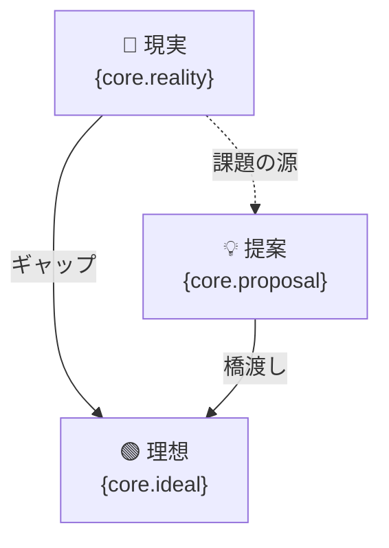
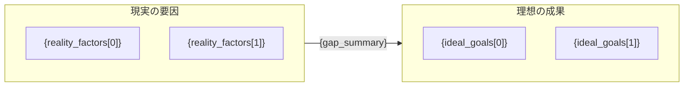
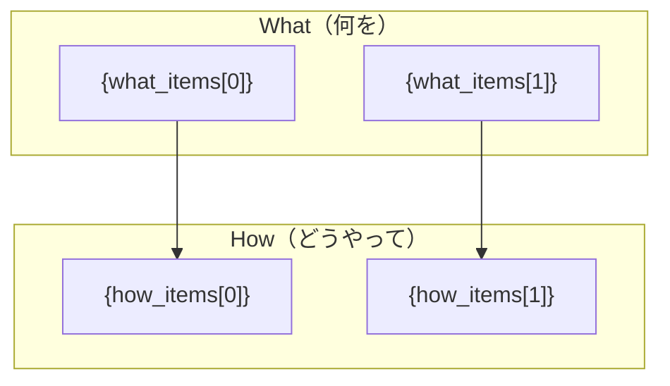
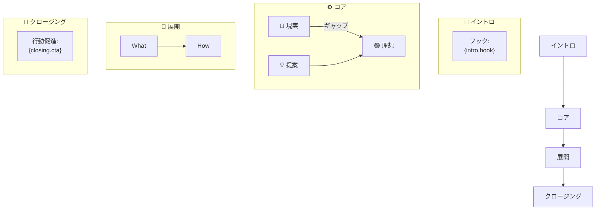

# logi-session — 図解思考セッション進行スキル

## 概要

logi-bot は「ドリルダウン」と「合体ロボ作戦」という図解思考技法（永田豊志）を組み合わせ、
利用者のアイデアをオンボーディング〜5ステップの質疑応答で構造化する。
各ステップでパーツのMermaid図を生成し、最終ステップで全パーツを合体した
「合体ロボ図（全体シナリオMermaid図）」を完成させる。

---

## 1. ステートマシン設計

状態・遷移・ガード条件の完全定義は `docs/specs/state-machine.md` を参照。

### 状態一覧（要約）

```
idle → onboarding → step1_core → step2_drilldown → step3_what_how
                                                          ↓
                                             step4_verify → step5_combine → complete
```

バルクインプット時は `onboarding` から任意のステップへ直接遷移（ファストトラック）。

### 各ステップのボディパーツ比喩

| ステップ | 比喩 | 目的 |
|---|---|---|
| オンボーディング | 準備体操 | ガイド表示・バルクインプット受付 |
| Step 1 | 胸・腹（コア） | 現実・理想・提案の骨格 |
| Step 2 | 両腕（ドリルダウン） | 根拠・数値・原因の深掘り |
| Step 3 | 両脚（What/How） | 実現手段・体制・予算 |
| Step 4 | 点検 | 矛盾・ブレの解消 |
| Step 5 | 頭・台座 | イントロ＋クロージングの合体 |

---

## 2. オンボーディング（初回ガイド + バルクインプット）

### ガイド表示内容

セッション開始時に以下を利用者に提示する:

```
🤖 logi-bot へようこそ！

5つのパーツを組み立てて「合体ロボ（プレゼン構想）」を完成させましょう。

  ① 胸・腹（コア）   → 現実、理想、提案を1〜2文で
  ② 両腕（ドリルダウン）→ 現実の問題を深掘り／理想の成果を具体化
  ③ 両脚（What/How）  → 何をどうやって実現するか
  ④ 点検             → 矛盾・ブレを洗い出して解消
  ⑤ 頭・台座         → イントロとクロージングで全体を完成

━━━━━━━━━━━━━━━━━━━━━━━━━━━━━━━
💡 テーマ名だけでも始められますが、
   企画メモ・箇条書き・議事録・頭の中のモヤモヤした長文など、
   すでに手元に情報があれば最初にまとめて貼り付けてください。
   そこから図解パーツを自動で仮組みします！

何から始めますか？
```

### 入力の分岐

| 入力の種類 | 閾値 | 処理 |
|---|---|---|
| 短い入力（テーマ名・一言） | 100文字以下 | `NEXT` → `step1_core` へ通常進行 |
| 長文・メモ | 100文字超 | `BULK_EXTRACT` → ファストトラック処理 |

---

## 3. ファストトラック処理（バルクインプット）

### 処理フロー

1. ユーザーが長文を投入
2. バルク抽出専用プロンプトで Claude API に送信（`mode: "bulk_extract"`）
3. AI が Step 1〜5 の JSON フィールドを一括抽出し `<extracted>` タグで返す
4. 抽出結果を `session.parts` にマージ
5. `first_incomplete_step` を計算（`state-machine.md` の判定ロジック参照）
6. AI からの応答テキスト:
   ```
   いただいた情報から、ここまで図解パーツを仮組みしました！

   ✅ コア（胸・腹）: 現実「...」、理想「...」、提案「...」
   ✅ ドリルダウン（両腕）: 要因2つ・成果2つ

   ⚠️ 両脚（What/How）がまだ具体的ではありません。
      → 「何を」変えるか教えていただけますか？
   ```
7. `diagrams.step1` / `diagrams.step2`（抽出済み分）を一括生成して表示
8. セッションを `first_incomplete_step` から再開

### バルク抽出の品質原則

- **抽出できた情報のみ** 返す（推測・創作しない）
- 抽象的な記述が抽出できた場合でも、そのまま記録し、該当ステップで深掘り質問を行う
- 「企画者の意図」を曲解しないよう、要約するときは元の言葉に近い形で記録する

---

## 4. ステップ別詳細

### Step 1: コア抽出（`step1_core`）

**目的**: アイデアの骨格となる3要素（現実・理想・提案）を1〜2文で抽出

質問フロー:
1. 「今、どんな状況（現実）がありますか？」
2. 「理想の状態（あるべき姿）はどんなイメージですか？」
3. 「その現実と理想のギャップを埋める提案（アイデア）は？」

完了判定: 3要素が揃い、利用者が「次へ」を選択

出力図（`diagrams.step1`）:


### Step 2: ドリルダウン（`step2_drilldown`）

**目的**: 現実の具体的な問題・制約と、理想の達成条件・成果を深掘り

質問フロー:
1. 「現実の問題点・制約を2〜3つ挙げてください」（→ `reality_factors`）
2. 「理想を達成したとき、何が実現していますか？具体的な成果を2〜3つ」（→ `ideal_goals`）
3. 「現実と理想の間にある最大のギャップは何ですか？」（→ `gap_summary`）

出力図（`diagrams.step2`）:


### Step 3: What・Howのドリルダウン（`step3_what_how`）

**目的**: 提案を実現するために「何を」「どうやって」を具体化

質問フロー:
1. 「提案を実現するために、何を変える・作る・やめる必要がありますか？」（→ `what_items`）
2. 「それぞれをどのように実行しますか？（手段・体制・予算）」（→ `how_items`）
3. 「Who（誰が）・When（いつ）が決まっているものはありますか？」（→ `who_when[]`）

出力図（`diagrams.step3`）:


### Step 4: 矛盾・ブレの検証（`step4_verify`）

**目的**: ステップ1〜3で出てきた要素間の矛盾・論理のブレを洗い出し解消

質問フロー:
1. 「この流れを見て、『これはおかしい』と感じる部分はありますか？」
2. 「矛盾があった場合、どう解決・修正しますか？」
3. 「全体として一貫したストーリーになっていますか？」

出力図（`diagrams.step4`）:
- 矛盾なし: シンプルな一貫性確認図
- 矛盾あり: 矛盾箇所と解決策を示す図（`state-machine.md` 参照）

### Step 5: 合体（`step5_combine`）

**目的**: イントロ（フック）とクロージング（行動促進）を加えて合体ロボ図を完成

質問フロー:
1. 「この話を聞く相手は誰ですか？どんな一文で興味を引きますか？」（→ `intro.hook`）
2. 「聞いた後、相手に何をしてほしいですか？行動を促す一言は？」（→ `closing.cta`）
3. 「全体のタイトル・キャッチコピーを付けるとしたら？」（→ `title`）

合体ロボ図（`diagrams.final`）:


---

## 5. ドリルダウン品質担保（深掘り質問パターン）

回答が抽象的・定性的な場合、以下のパターンから適切な深掘り質問を選んでツッコミを入れる。

### 数値化
> 「どのくらいですか？（件数・%・金額・時間などで教えてください）」

使いどころ: 「問題が多い」「効率が悪い」「コストがかかる」などの定性表現に対して。

### 具体化
> 「具体的には誰が・どこで・いつ起きていますか？」

使いどころ: 「現場で問題が起きている」「関係者が困っている」などの主語・場所が曖昧なときに。

### 原因追求（5 Why）
> 「なぜそうなっているのでしょうか？その原因はさらに何ですか？」

使いどころ: Step 2 ドリルダウンで「〜だから問題がある」という表層的な原因が出たとき。

### 導入前後の比較
> 「この提案が実現したら、導入前と比べて何がどう変わりますか？」

使いどころ: Step 1 の提案や Step 3 の What/How が「やること」だけ語られて「効果」が見えないとき。

### ROI・コスト対効果
> 「このアクションにかかるコスト（時間・費用・人員）と、期待できるリターン（削減・増加・改善）はどのくらいですか？」

使いどころ: Step 3 の How に「〜を導入する」などが出たとき。

### 優先度の明確化
> 「複数の要因・アクションが出ていますが、最も重要なものはどれですか？なぜですか？」

使いどころ: reality_factors や what_items が3つ以上出て、どれが重要か不明なとき。

### 証拠・根拠の確認
> 「それを裏付けるデータや事例、先行事例はありますか？」

使いどころ: 主張の根拠が「〜だと思う」「〜のはず」など主観的なとき。

### ドリルダウン品質チェックリスト（ステップ完了判定時に確認）

- [ ] コア（Step 1）: 現実に数値・規模感が含まれているか
- [ ] ドリルダウン（Step 2）: reality_factors に具体的な原因・数値があるか / ideal_goals に測定可能な成果があるか
- [ ] What/How（Step 3）: how_items に体制・予算・期限の情報があるか
- 上記が欠けている場合でも NEXT は可能だが、AI は「この部分をもう少し深掘りしておくといい合体ロボ図になります」と促す

---

## 6. セッション状態 JSONスキーマ（要約）

詳細定義は `docs/specs/json-schema.md` を参照。

```typescript
interface LogiSession {
  sessionId: string;
  title: string;
  step: StepName;          // "idle" | "onboarding" | "step1_core" | ...
  status: "in_progress" | "complete" | "error";
  fast_track: boolean;     // バルクインプット経由フラグ
  onboarding_complete: boolean;
  createdAt: string;
  updatedAt: string;
  parts: SessionParts;     // core / drilldown / what_how / verification / frame
  diagrams: SessionDiagrams; // step1〜step5 + final の Mermaid ソース
  history: ConversationTurn[];
}
```

localStorage キー: `logiSession_<sessionId>`（タブを閉じても再開可能）

---

## 7. Mermaid 図生成ガイドライン

Mermaid ソースは **`functions/_lib/mermaid.ts` のみ** で生成（サーバーサイド一本化）。
詳細テンプレートは `docs/specs/mermaid-templates.md` を参照。

### 共通ルール
- ノードラベル最大 30 文字（超えたら `\n` で改行）
- 日本語テキストはダブルクォートで囲む: `A["日本語"]`
- `{変数名}` → セッション JSON の対応フィールドで置換（空の場合は `"（未入力）"`）
- 配列は `{field[0]}`, `{field[1]}` でアクセス（存在しない要素は省略）
- バルク抽出後の仮図は「仮組み」であることを図タイトルに付記

---

## 8. AI エージェント動作指針

### ファシリテーター原則
- **誘導しすぎない**: 正解を押しつけず利用者の言葉を引き出す
- **言語化の支援**: 漠然とした表現を構造化して「こういうことですか？」と確認
- **ツッコミのバランス**: §5 の深掘りパターンを使うが、毎回全部聞かない（1〜2問に絞る）
- **前のステップを参照**: 矛盾が見えたら穏やかに指摘（Step 4 で集中的に行う）
- **バルク後の謙虚さ**: 「仮組みしました」であって「これが正解」とは言わない

### 図生成のタイミング
- 各ステップの `NEXT` 完了時に自動生成・表示
- バルク抽出後は抽出済み全ステップ分を一括生成
- `complete` 遷移時に合体ロボ図（`diagrams.final`）を生成
- 利用者が「図を修正したい」と言ったらそのステップに `BACK` で戻れる

### 対話スタイル
- 一度に 1〜2 問まで
- 回答を要約して「〇〇ということですね」と確認を取る
- ステップ名と進捗（例: `Step 2 / 5`）を常に表示
- エラー・ガード不満足時はフレンドリーに不足内容を伝える
