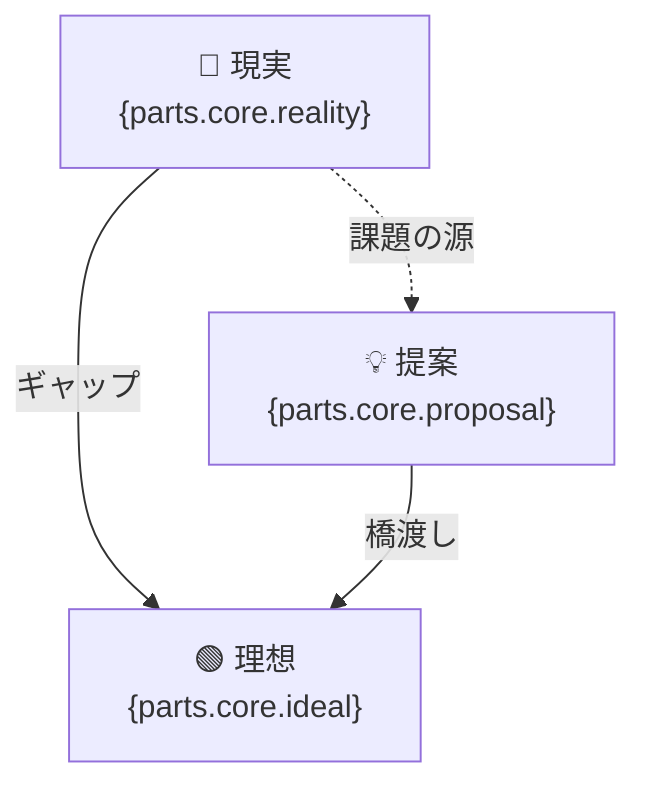
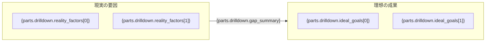
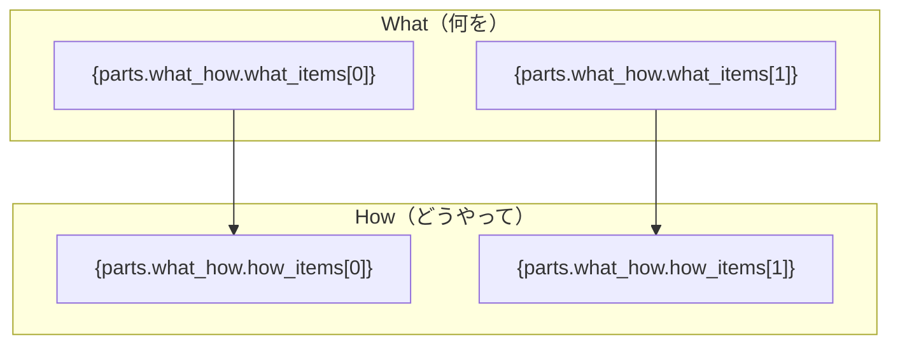
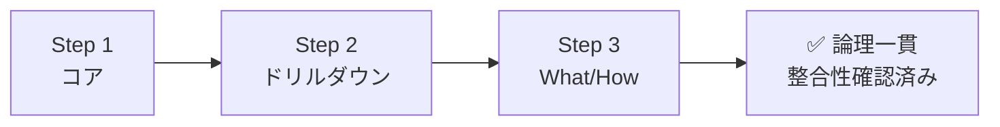
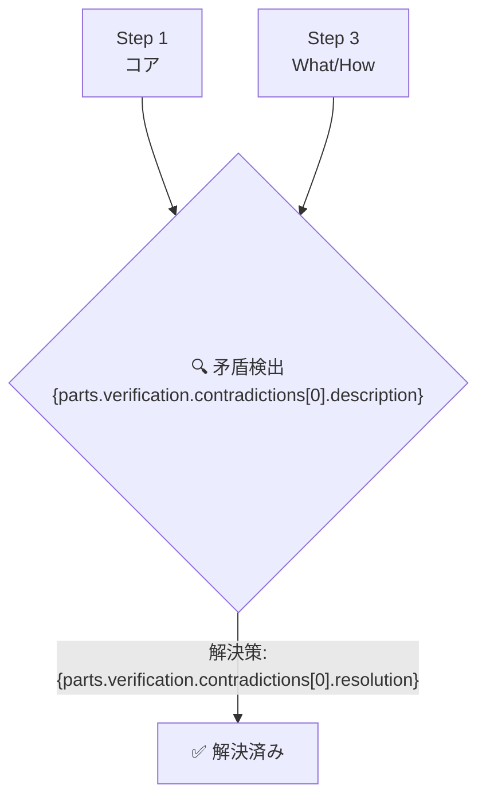
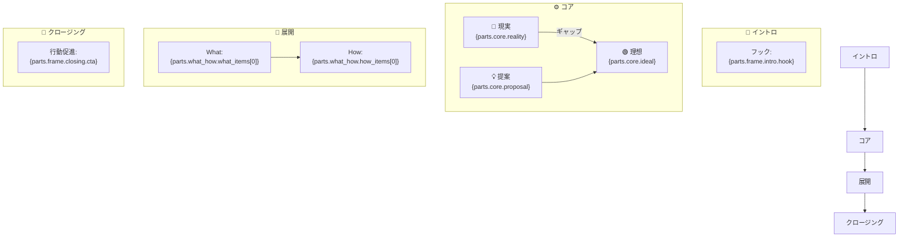

# 仕様: Mermaid テンプレート設計

> 根拠: PLAN.md §4 / `.claude/skills/logi-session/SKILL.md`
> 実装: **`functions/_lib/mermaid.ts` のみ**（サーバーサイド一本化、2026-10-16決定）
> クライアントは Mermaid ソース文字列を受け取り Mermaid.js で描画するだけ。`mermaid-builder.js` は不要。

## 共通ルール

- ノードラベルは **最大30文字**（超える場合は `\n` で改行）
- 日本語テキストはダブルクォートで囲む: `A["日本語テキスト"]`
- `{変数名}` はセッション JSON の対応フィールドに置換（空の場合は `"（未入力）"`）
- 配列要素は `{field[0]}`, `{field[1]}` でアクセス（要素が存在しない場合はノードを省略）
- 最大ノード数: 8個/図（超える場合は重要な3〜4個に絞る）

---

## Step 1: コア図（`diagrams.step1`）

方向: `flowchart TB`



### ノード配色（CSS クラスで適用）

| ノード | クラス | 意味 |
|---|---|---|
| 現実 (`R`) | `node-reality` | 赤系（問題・現状） |
| 理想 (`I`) | `node-ideal` | 緑系（目標・未来） |
| 提案 (`P`) | `node-proposal` | 青系（解決策） |

---

## Step 2: ドリルダウン図（`diagrams.step2`）

方向: `flowchart LR`



### 可変ノード数の扱い

- `reality_factors` と `ideal_goals` の要素数は動的に変わる
- テンプレートエンジンは存在する要素分だけノードを生成する
- サブグラフ間のエッジラベルに `gap_summary` を使う（空の場合は「変革」）

---

## Step 3: What/How 図（`diagrams.step3`）

方向: `flowchart TB`



### What と How の対応

- `what_items[i]` と `how_items[i]` を同じインデックスでペアにする
- `who_when` が存在する場合は注釈として右端に追加（`:::who-when` スタイル）

---

## Step 4: 検証図（`diagrams.step4`）

### パターン A: 矛盾なし（`contradictions.length == 0`）



### パターン B: 矛盾あり・解決済み（`contradictions.length > 0`）



---

## Step 5 / Final: 合体ロボ図（`diagrams.step5` / `diagrams.final`）

**logi-bot のメインアウトプット。全ステップのエッセンスを1枚に統合する。**

方向: `flowchart TB`



### タイトルの付与

`title` が設定されている場合、図の上部に `---\ntitle: {parts.frame.title}\n---` を付ける（Mermaid v10+ のフロントマター構文）。

### 合体ロボ図の拡張バリエーション

情報量が多い場合は以下のように縦長構成にして省略ノードを使う:

```mermaid
flowchart TB
  H["🎯 {parts.frame.intro.hook}"]
  :::intro

  R["🔴 現実"] --> |GAP| I["🟢 理想"]
  P["💡 提案"] --> I
  :::core

  W1["{what_items[0]}"] --> H1["{how_items[0]}"]
  W2["{what_items[1]}"] --> H2["{how_items[1]}"]
  :::whatHow

  CTA["🏁 {parts.frame.closing.cta}"]
  :::closing

  H --> R
  I --> W1
  H2 --> CTA
```

---

## Mermaid レンダリング方針

### クライアントサイド
- **Mermaid.js v11（CDN）** を使用: `https://cdn.jsdelivr.net/npm/mermaid@11/dist/mermaid.min.js`
- 初期化: `mermaid.initialize({ startOnLoad: false, theme: 'default' })`
- 動的レンダリング: `mermaid.render(id, source)` → SVG を取得して DOM に挿入
- テーマ: デフォルト（ライト）。将来ダークモード切り替えを追加可能

### テンプレートエンジン（`mermaid-builder.js`）
- `buildDiagram(step: StepName, session: LogiSession): string` で Mermaid ソースを返す
- `{変数名}` を正規表現で置換
- 配列は要素数に応じてノード群を動的生成
- 30文字超のラベルは自動で `\n` を挿入して折り返す
- 特殊文字（`"`, `#`, `&` 等）は Mermaid エスケープルールに従い処理する
